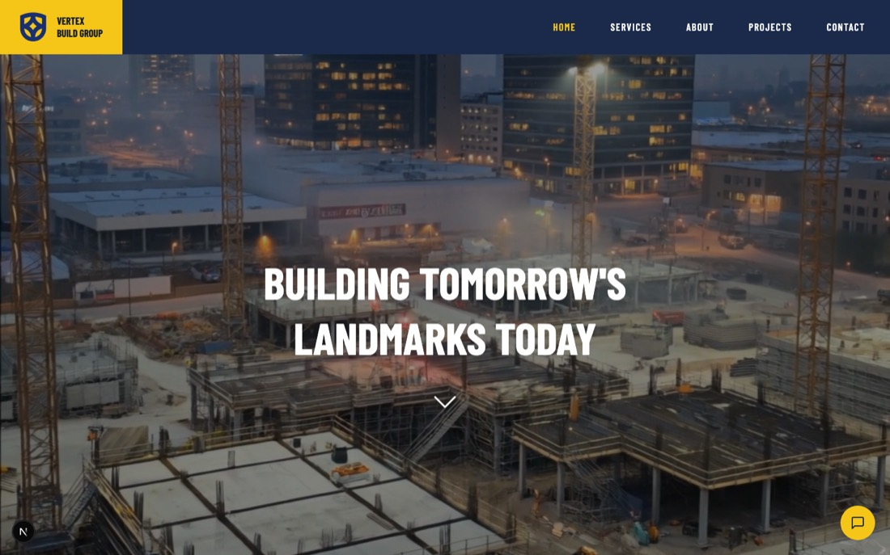

# Vertex Build Group

A marketing website for a fictional commercial and infrastructure construction company, built with Next.js and Tailwind CSS.

**Live demo:** https://vertex-build-smoky.vercel.app



## Features

- Full-screen video hero
- Project detail pages generated at build time with `generateStaticParams`
- Scroll-triggered reveal animations (IntersectionObserver)
- Responsive layouts from phone to desktop, with accessible labels on interactive controls
- Statically generated for fast loading

## Tech stack

Next.js 16 (App Router), React 19, TypeScript, Tailwind CSS v4. Deployed on Vercel.

## Run locally

```bash
npm install
npm run dev
```

Then open http://localhost:3000.

## Note

Vertex Build Group is a fictional company. All names, contact details and content are placeholders. Designed and built by Habane Assoweh.
